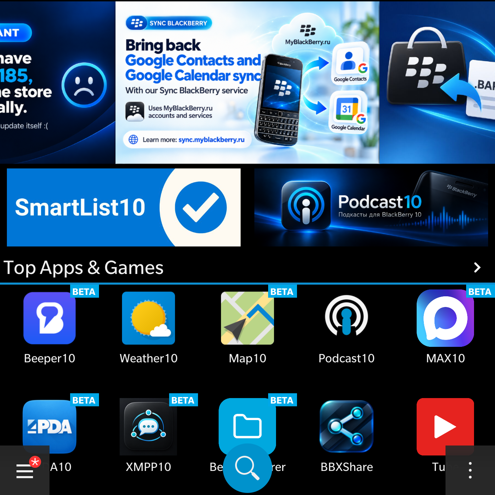
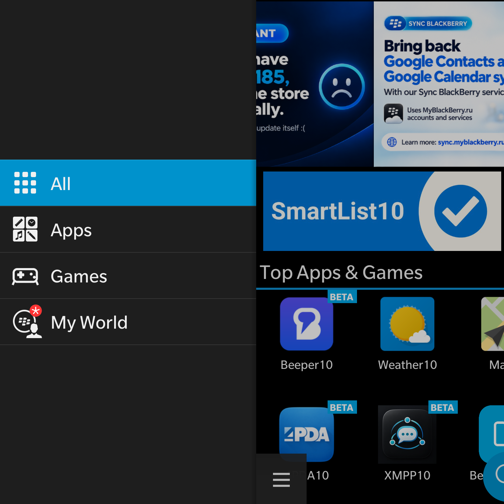
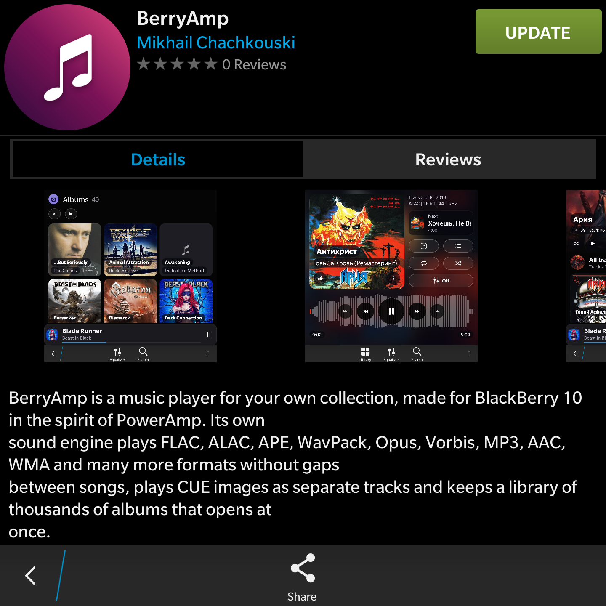
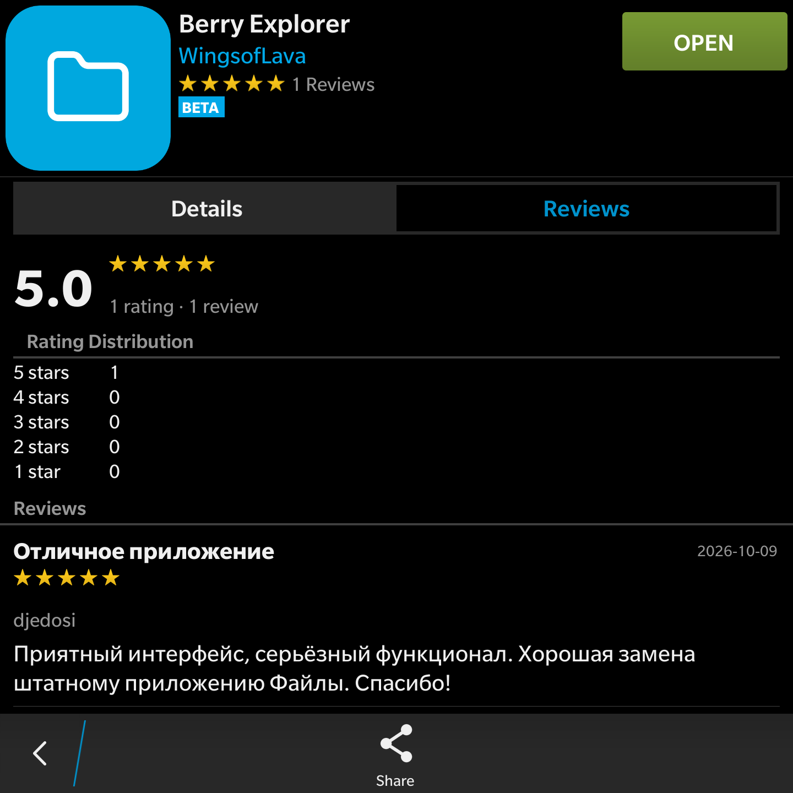
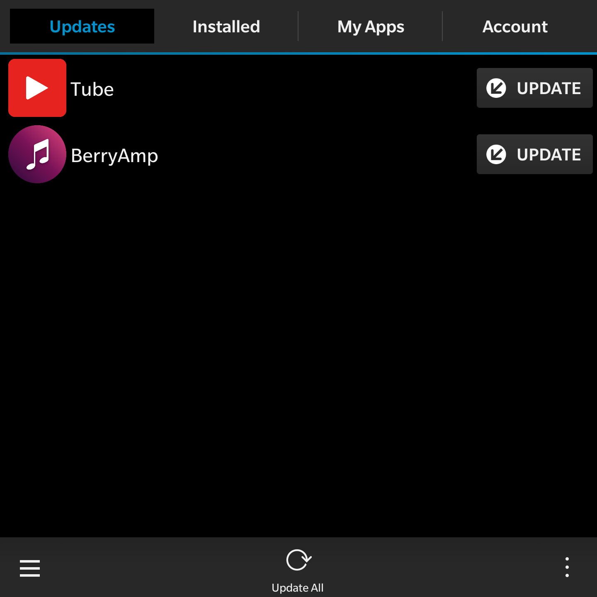

# BlackBerry World

**A community-driven app store for BlackBerry 10.**

Discover native applications and games for BlackBerry 10, browse app details, download BAR packages, and manage your apps — directly from your BlackBerry device.

[**Download the latest BlackBerry World release**](https://github.com/MyBlackBerry-ru/BlackBerry-World/releases/latest) · [**Visit MyBlackBerry.ru**](https://myblackberry.ru/) · [**Report an issue**](https://github.com/MyBlackBerry-ru/BlackBerry-World/issues)

---

## About

BlackBerry World is an independent community project created to help keep BlackBerry 10 useful. It brings together a growing catalog of native BB10 apps, games and utilities in a familiar BlackBerry-style interface.

The store connects to **MyBlackBerry.ru** for its live catalog and supported online features. GitHub is an additional home for project information, issue reports and downloadable releases.

## Features

- **Native BlackBerry 10 experience** — built with Cascades and Qt, not an Android app.
- **Discover apps and games** — curated storefront sections, categories and search.
- **App details** — descriptions, screenshots, version information and compatibility.
- **Direct BAR downloads and installation** — install supported applications from the store.
- **My World** — view your apps and available updates.
- **MyBlackBerry account** — sign in and access your app library.
- **Reviews and ratings** — see community feedback and submit your own reviews.
- **Share apps** — send an app link to friends.
- **Store updates** — install newer versions of BlackBerry World when available.

## Download and installation

**Latest version:** [BlackBerry World for BB10 — Releases](https://github.com/MyBlackBerry-ru/BlackBerry-World/releases/latest)

1. Open the latest GitHub release.
2. Under **Assets**, download the `BlackBerry-World-*.bar` file.
3. Install the BAR on your BlackBerry 10 device using a compatible BAR sideloading tool.
4. Open BlackBerry World and browse the catalog.

> The BAR file is the installable application. GitHub's automatically generated **Source code** archives are repository snapshots, not BAR installers.

## Compatibility

- **Platform:** BlackBerry 10 (native ARMv7 / Cascades).
- **OS:** BlackBerry 10.3.x.
- **Device-tested:** BlackBerry Passport, OS 10.3.3.3216.
- **Connection:** Internet access is required for online catalog and account features.

Availability of individual apps depends on their own device compatibility and release requirements.

## Community and support

Have a bug report, suggestion or idea? [Open a GitHub Issue](https://github.com/MyBlackBerry-ru/BlackBerry-World/issues).

For the wider BlackBerry community, apps and downloads, visit **[MyBlackBerry.ru](https://myblackberry.ru/)**.

## Disclaimer

BlackBerry World is an independent community project and is not affiliated with, endorsed by or sponsored by BlackBerry Limited. BlackBerry and related names and trademarks belong to their respective owners.

## Screenshots

  
  
  
  
  

